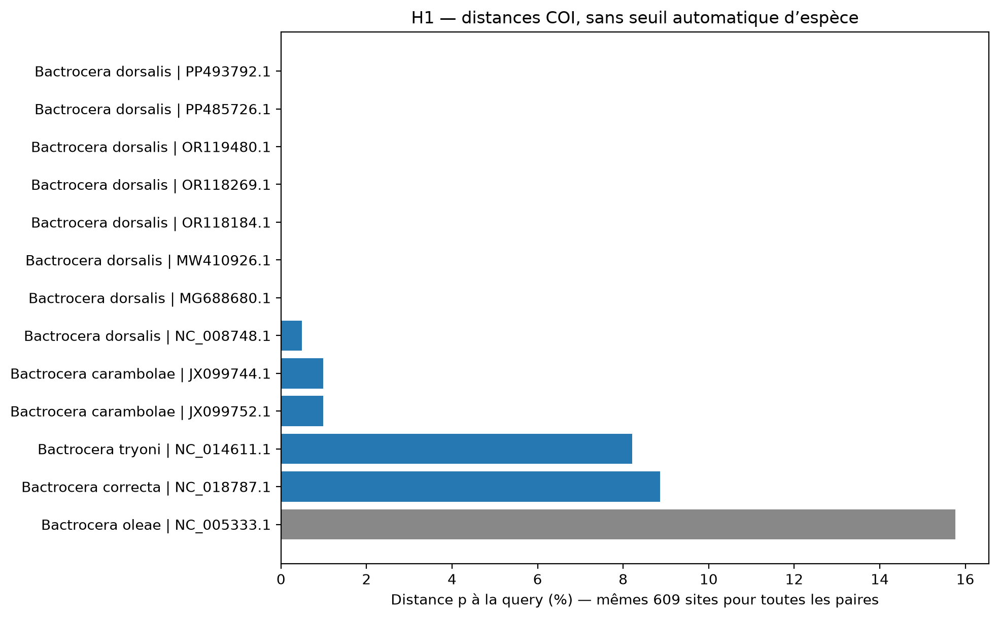
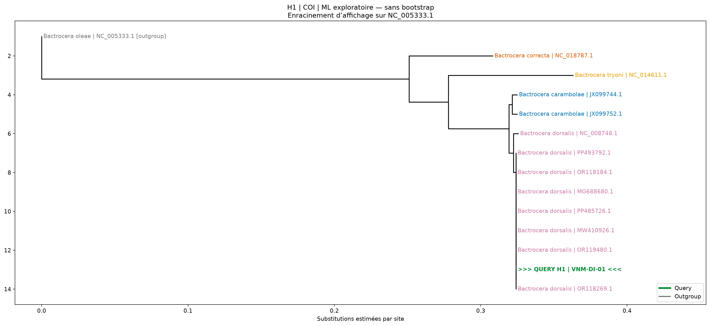
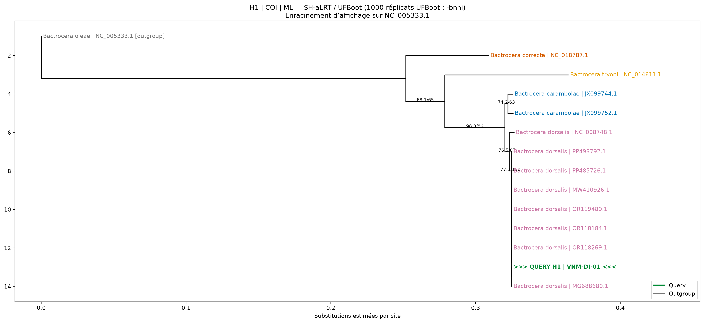

# Identification et phylogénie COI d’insectes à partir de séquences Sanger

Tutoriel : des chromatogrammes AB1 au consensus, à BLAST et à un arbre de maximum de vraisemblance. L’exemple documenté est l’échantillon **H1**, présumé *Bactrocera* sp. 

Ce dépôt décrit un workflow de travail auditable, pas une méthode diagnostique réglementaire validée. Une identité COI élevée et un arbre soutenu ne suffisent pas toujours à départager les espèces proches.

## Sommaire

1. [Résultats de l’exemple H1](#1-résultats-de-lexemple-h1)
2. [Organisation du dépôt et fichiers à déposer](#2-organisation-du-dépôt-et-fichiers-à-déposer)
3. [Installer et vérifier les outils](#3-installer-et-vérifier-les-outils)
4. [Configurer un échantillon](#4-configurer-un-échantillon)
5. [Contrôler les chromatogrammes](#5-contrôler-les-chromatogrammes)
6. [Assembler et examiner le consensus](#6-assembler-et-examiner-le-consensus)
7. [Déterminer le cadre et valider](#7-déterminer-le-cadre-et-valider)
8. [Archiver BLAST et préparer les références](#8-archiver-blast-et-préparer-les-références)
9. [Télécharger et auditer GenBank](#9-télécharger-et-auditer-genbank)
10. [Aligner et calculer les distances](#10-aligner-et-calculer-les-distances)
11. [Reconstruire et dessiner les arbres](#11-reconstruire-et-dessiner-les-arbres)
12. [Bilan et interprétation](#12-bilan-et-interprétation)
13. [Adapter et dépanner](#13-adapter-et-dépanner)
14. [Reproductibilité et publication](#14-reproductibilité-et-publication)

## 1. Résultats de l’exemple H1

Le [guide initial](docs/Guide_COI_H1.docx) décrit le pipeline ; le présent tutoriel ajoute les étapes de dépannage et de vérification nécessaires pendant l’analyse.

| Point de contrôle | Résultat H1 |
|---|---|
| LCO : longueur brute → retenue | 955 → 651 bases, positions brutes 20–670 |
| HCO : longueur brute → retenue | 1001 → 663 bases, positions brutes 10–672 |
| Qualité PHRED moyenne retenue | LCO 51,75 ; HCO 51,04 |
| Consensus | 609 bases ; aucun N ; aucun indel interne détecté |
| Accord des deux lectures de qualité | 594 positions, 100 % d’accord |
| Cadre de traduction retenu | Brin `+`, décalage `2`, table mitochondriale 5 |
| Meilleurs hits BLAST présentés | 100 % d’identité, 100 % de couverture, dépôts nommés *B. dorsalis* |
| Références conservées à l’étape 04 | 13 références : 12 `reference`, 1 `outgroup` dans le panel décrit |
| Distances affichées à l’étape 05 | Sept références *B. dorsalis* à 0/609 ; NC_008748.1 à 3/609 ; deux *B. carambolae* à 6/609 |
| Arbres documentés par les commandes | ML exploratoire, puis UFBoot + SH-aLRT, affichage enraciné sur NC_005333.1 |

## 2. Organisation du dépôt

```text
COI_Sanger_modulaire/
├── README.md
├── 00_installer.command
├── scripts/
│   ├── common.py
│   ├── 01_qc_ab1.py
│   ├── 02_consensus.py
│   ├── 03_valider_consensus.py
│   ├── 04_references_genbank.py
│   ├── 05_alignement_distances.py
│   ├── 06_phylogenie.py
│   ├── 07_tracer_arbre.py
│   └── 08_bilan.py
├── configs/
│   └── H1.json                     
├── references/
│   └── H1.tsv                      # panel final, pas seulement les hits BLAST
├── docs/
│   ├── Protocole.txt                # protocole réalisé pour ce tuto 
│   └── Guide_COI_H1.docx            # guide original fourni
├── data/
│   └── raw/H1/                     # AB1 files
├── environment/
│   ├── versions.txt
│   ├── environnement_conda.yml
│   └── environnement_conda_explicit.txt
└── analyses/
    └── H1/
        ├── 01_qc/
        ├── 02_consensus/
        ├── 03_blast/
        ├── 04_references/
        ├── 05_alignment/
        ├── 06_trees/
        ├── 07_plots/
        ├── logs/
        ├── consensus_approved.json
        ├── alignment_approved.json
        └── BILAN_PROVISOIRE.md
```

## 3. Installer et vérifier les outils

Prérequis : Conda ou Miniforge installé, accès Internet pour BLAST et les téléchargements NCBI, Terminal et éditeur de texte brut. Les commandes `open` et `pbcopy` sont spécifiques à macOS ; sur un autre système, ouvrir/copier les fichiers avec les outils disponibles.

Depuis la racine du projet :

```bash
bash 00_installer.command
```

Le script crée l’environnement `coi_sanger` avec Python, Biopython, NumPy, Matplotlib, MAFFT et IQ-TREE. Conserver `common.py` avec les autres scripts.

### Cas rencontré : erreurs des extensions Conda

Pendant l’installation de H1, Conda affichait :

```text
Error while loading conda entry point: conda-anaconda-telemetry
Error while loading conda entry point: conda-anaconda-tos
```

L’installation a néanmoins terminé et les imports ont réussi. Ces messages provenaient du chargement d’extensions dans `base`, pas d’un échec démontré des outils de `coi_sanger`. La solution utilisée pour poursuivre était d’appeler les outils de l’environnement directement ; ce contournement ne répare pas les extensions de `base`.

Vérifier d’abord avec le chemin de son installation Conda :

```bash
"$HOME/miniconda3/envs/coi_sanger/bin/python" -c '
import sys, Bio, matplotlib, numpy
print("Python :", sys.executable)
print("Version Python :", sys.version.split()[0])
print("Biopython :", Bio.__version__)
print("Matplotlib :", matplotlib.__version__)
print("NumPy :", numpy.__version__)
print("Imports OK")
'
```

Versions observées sur le Mac de l’exemple :

```text
Python : /Users/Mac/miniconda3/envs/coi_sanger/bin/python
Version Python : 3.11.18
Biopython : 1.85
Matplotlib : 3.11.2
NumPy : 2.4.6
Imports OK
```

Puis, dans chaque nouvelle session de Terminal utilisée pour ce tutoriel :

```bash
export PATH="$HOME/miniconda3/envs/coi_sanger/bin:$PATH"
python -c 'import sys; print(sys.executable)'
command -v mafft
mafft --version
python -c 'import shutil; print(shutil.which("iqtree3") or shutil.which("iqtree2") or shutil.which("iqtree"))'
```

Adapter `miniconda3` à son installation. Pour H1, MAFFT répondait `v7.526` et `iqtree3` était trouvé. Le plan d’installation indiquait IQ-TREE 3.1.4 ; vérifier la version effectivement exécutée avec `iqtree3 -version`. L’invite peut encore afficher `(base)` : le chemin retourné par `sys.executable` et les exécutables trouvés sont les vérifications pertinentes ici.

Les commandes suivantes utilisent `python` après ce réglage du `PATH`. Autre possibilité si Conda fonctionne normalement : `conda run --no-capture-output -n coi_sanger python scripts/...`.

## 4. Configurer un échantillon

Se placer à la racine du dépôt, puis ouvrir :

```bash
pwd
ls scripts
open -e configs/H1.json
```

Pour l’exemple H1 :

| Champ | Valeur / action |
|---|---|
| `sample` | `H1` |
| `field_id` | `VNM-DI-01` |
| `presumed_taxon` | `Bactrocera sp.` ; hypothèse, pas filtre imposé au BLAST |
| `raw_dir` | Dossier local contenant les AB1 |
| `forward_ab1` | `VNM-D1-01-LCO_F11_085.ab1` |
| `reverse_ab1` | `VNM-D1-01-HCO_F11_085.ab1` |
| `mapping_confirmed` | `true` uniquement après vérification de la correspondance |
| `email` | Adresse de contact locale pour NCBI |
| `references_file` | `references/H1.tsv` |

### Paramètres de travail initiaux

| Paramètre | Défaut | Sens |
|---|---:|---|
| `quality_window` | 20 | Fenêtre de contrôle qualité |
| `quality_window_mean` | 25 | Moyenne PHRED minimale de fenêtre |
| `min_base_q` | 20 | Qualité minimale d’une base utilisable |
| `min_read_bp` | 200 | Lecture retenue minimale |
| `min_overlap_bp` | 200 | Positions appariées de qualité minimales |
| `min_pair_identity` | 0.97 | Accord bidirectionnel minimal |
| `max_consensus_n_fraction` | 0.02 | Fraction maximale de N |
| `genetic_code` | 5 | Table mitochondriale des invertébrés |
| `min_reference_comparable_bp` | 450 | Bases comparables minimales d’une référence |
| `min_reference_coverage` | 0.8 | Couverture minimale de la query |
| `min_alignment_columns` | 450 | Sites communs minimaux |

Ce sont des choix de travail explicites, pas des seuils diagnostiques universels.

## 5. Contrôler les chromatogrammes

```bash
python scripts/01_qc_ab1.py configs/H1.json
cat analyses/H1/01_qc/summary.tsv
open analyses/H1/01_qc/forward_chromatogrammes.pdf
open analyses/H1/01_qc/reverse_chromatogrammes.pdf
```

Le script lit les bases et qualités AB1, retient une plage de qualité et cherche les amorces près des extrémités. Les `.seq` seuls ne fournissent pas le même audit. Examiner les traces, la qualité, le début et la fin retenus, les doubles pics et les éventuelles anomalies.

Résultat H1 consigné :

| Lecture | Bases brutes | Début retenu | Fin retenue | Bases retenues | PHRED moyen |
|---|---:|---:|---:|---:|---:|
| LCO / forward | 955 | 20 | 670 | 651 | 51,75 |
| HCO / reverse | 1001 | 10 | 672 | 663 | 51,04 |

Les coordonnées brutes sont 1-based, bornes incluses. Le champ `primers_removed` est vide dans cette sortie : aucun retrait d’amorce n’y est signalé, ce qui n’établit pas à lui seul la présence ou l’absence d’amorce dans les lectures.

Consulter : [table QC](analyses/H1/01_qc/summary.tsv), [chromatogrammes LCO](analyses/H1/01_qc/forward_chromatogrammes.pdf), [chromatogrammes HCO](analyses/H1/01_qc/reverse_chromatogrammes.pdf).

Si un trimming manuel est nécessaire, renseigner des coordonnées brutes dans `raw_trim_1based`, puis refaire 01 et 02. Ne pas recopier les coordonnées de H1 sur un autre échantillon.

## 6. Assembler et examiner le consensus

```bash
python scripts/02_consensus.py configs/H1.json
cat analyses/H1/02_consensus/summary.json
```

Le script compare HCO brut et son complément inverse à LCO ; les qualités sont retournées avec les bases. Le consensus est limité à la région couverte par les deux lectures. Il conserve une base si deux appels de qualité concordent ou si un seul appel est utilisable, avec un statut explicite ; un conflit de haute qualité donne un N. Les indels internes et certains seuils insuffisants provoquent un arrêt.

Résultat H1 :

```json
{
  "overlap_columns": 609,
  "high_quality_paired_sites": 594,
  "pair_identity": 1.0,
  "internal_indel_columns": 0,
  "consensus_bp": 609,
  "n_count": 0,
  "n_fraction": 0.0,
  "score_hco_as_is": 8.0,
  "score_hco_reverse_complement": 1174.0
}
```

L’accord de 100 % porte sur les 594 positions où les deux appels sont utilisables : ce n’est ni 609 confirmations doubles de haute qualité ni une identité avec une espèce. Les 15 autres colonnes du consensus doivent être expliquées par les statuts de l’audit ; ne pas inventer leur répartition LCO/HCO.

```bash
python - <<'PY'
import csv
from collections import Counter
with open("analyses/H1/02_consensus/base_audit.tsv") as f:
    counts = Counter(r["status"] for r in csv.DictReader(f, delimiter="\t")
                     if r["consensus_position"])
for status, count in sorted(counts.items()):
    print(status, count, sep="\t")
PY
```

Examiner [l’audit base par base](analyses/H1/02_consensus/base_audit.tsv), [l’alignement bidirectionnel](analyses/H1/02_consensus/pair_alignment.txt) et [le candidat FASTA](analyses/H1/02_consensus/candidate.fasta). Ne pas remplacer une base ambiguë par celle d’une référence BLAST.

## 7. Déterminer le cadre et valider

### 7.1. Afficher les six cadres

```bash
python - <<'PY'
import csv
with open("analyses/H1/02_consensus/translation_six_frames.tsv") as f:
    rows = list(csv.DictReader(f, delimiter="\t"))
print("Brin | Decalage | Longueur AA | STOP | AA inconnus")
for r in rows:
    print(" | ".join(r[k] for k in ["strand", "offset_0based", "aa_length",
                                    "stop_count", "unknown_aa"]))
PY
```

Résultat H1 :

| Brin | Décalage | Longueur AA | STOP | AA inconnus |
|---|---:|---:|---:|---:|
| + | 0 | 203 | 27 | 0 |
| + | 1 | 202 | 4 | 0 |
| + | 2 | 202 | 0 | 0 |
| − | 0 | 203 | 12 | 0 |
| − | 1 | 202 | 24 | 0 |
| − | 2 | 202 | 2 | 0 |

Pour H1, `+ / 2` est le seul cadre sans STOP. Ce n’est pas une règle à imposer aux autres insectes. L’absence de STOP, seule, ne prouve ni l’homologie COI ni l’absence de pseudogène.

### 7.2. BLAST exploratoire du candidat

Avant approbation, copier le candidat tel quel :

```bash
pbcopy < analyses/H1/02_consensus/candidate.fasta
open 'https://blast.ncbi.nlm.nih.gov/Blast.cgi?PAGE_TYPE=BlastSearch'
```

Choisir Nucleotide BLAST, coller le FASTA, commencer sans restriction à *Bactrocera*. Ne pas ajouter `+2` dans le FASTA et ne pas supprimer les deux premières bases. Examiner couverture, identité, gaps et concurrents taxonomiques.

Les quatre résultats présentés pour H1 avaient 100 % de couverture et 100 % d’identité : PP493792.1, PP485726.1, OR119480.1 et OR118269.1, tous déposés comme *B. dorsalis*.

### 7.3. Confirmer la phase avec « CDS feature »

Dans « Alignments », choisir une référence annotée COI et activer « CDS feature ». Le protocole décrit la vérification sur OR119480.1 : Query 1–609 correspond à Subject 24–632, sans gap, 609/609 identités. `Plus/Plus` exprime le sens relatif des séquences, pas un décalage de zéro.

Le début de la traduction affichée est `W A G M V G T S…` :

```text
Query : CC | TGA | GCA | GGA | ATA | GTA | GGA | ACA | ...
AA    :       W     A     G     M     V     G     T
```

Les deux bases initiales appartiennent à un codon incomplet ; le premier codon complet couvre les bases 3–5. Cela correspond à `offset=2` (0-based), ou `codon_start=3` pour le fragment. La table 5 traduit TGA en tryptophane W. Le NCBI explique que les lettres d’acides aminés sont centrées sur les codons dans cet affichage : [aide à la détermination du cadre](https://support.nlm.nih.gov/knowledgebase/article/KA-05229/en-us).

### 7.4. Valider explicitement

Seulement après revue réelle des chromatogrammes et de la phase :

```bash
python scripts/03_valider_consensus.py configs/H1.json \
  --strand + --offset 2 --approve \
  --comment "Chromatogrammes inspectés ; phase COI +2 confirmée par affichage CDS BLAST ; aucun STOP avec la table mitochondriale 5"
```

Le script crée `03_blast/query.fasta` et `consensus_approved.json`, avec paramètres, commentaire et empreintes. Il ne vérifie pas lui-même les affirmations du commentaire. Le consensus reste de 609 bases : le décalage sert à la traduction, pas à tronquer le FASTA.

Incident rencontré : utiliser `--offset 0` a produit `ERREUR : Cadre avec codon STOP`. C’était un refus du cadre demandé, pas une preuve d’échec du consensus. La tentative a été arrêtée avant écriture de l’approbation. Ne pas contourner le contrôle en modifiant les fichiers de validation.

## 8. Archiver BLAST et préparer les références

### 8.1. Recherche sur la query validée

```bash
pbcopy < analyses/H1/03_blast/query.fasta
```

Lancer et archiver la recherche. Pour H1 :

```text
Date documentée : 10 novembre 2026
RID du candidat : F5WC5DTB016
RID de la query validée : F5XCKAV5016
Query : QUERY_H1 manually_reviewed_consensus
Longueur : 609 bases
Programme indiqué : BLASTN
Base indiquée : core_nt — Core nucleotide BLAST database
```

Ne pas confondre ces deux RID. L’en-tête `BLASTN` seul ne prouve pas quelle tâche précise (par exemple megablast) a été sélectionnée : conserver aussi les paramètres disponibles ou une capture de la recherche.

### 8.2. Quels téléchargements ?

- « Text » : rapport avec en-tête, tableau et alignements détaillés.

Exemple exécuté pour le rapport texte :

```bash
cp "$HOME/Downloads/F5XCKAV5016-Alignment.txt" \
   analyses/H1/03_blast/H1_BLAST_2026-11-10_F5XCKAV5016_report.txt

grep -n -E '^(Query|Sbjct)[[:space:]]+[0-9]+' \
  analyses/H1/03_blast/H1_BLAST_2026-11-10_F5XCKAV5016_report.txt | head
```

Les lignes Query/Sbjct présentes confirment que l’export inclut les alignements inspectés. Archiver la Hit table du même RID, par exemple sous `H1_BLAST_2026-11-10_F5XCKAV5016_hit_table.txt`, et les informations de recherche dans `H1_BLAST_2026-11-10_F5XCKAV5016_metadata.txt`. L’empreinte de la query validée est dans `analyses/H1/consensus_approved.json`.

[Rapport BLAST H1](analyses/H1/03_blast/H1_BLAST_2026-11-10_F5XCKAV5016_report.txt) · [Hit table](analyses/H1/03_blast/H1_BLAST_2026-11-10_F5XCKAV5016_hit_table.txt) · [Métadonnées](analyses/H1/03_blast/H1_BLAST_2026-11-10_F5XCKAV5016_metadata.txt)

### 8.3. Extraire les accessions dans le bon ordre de colonnes

Le bloc suivant, ajouté pendant l’analyse, transforme le tableau du rapport en TSV sans doublons d’accession. Il n’écrase pas le panel final. Il est adapté au format texte BLAST observé ; si l’interface change le format, vérifier le résultat avant utilisation.

```bash
python - <<'PY'
import re
from pathlib import Path

folder = Path("analyses/H1/03_blast")
source = folder / "H1_BLAST_2026-11-10_F5XCKAV5016_report.txt"
destination = folder / "H1_references_depuis_BLAST.tsv"
rows, seen = [], set()
in_table = False

for line in source.read_text().splitlines():
    if "Sequences producing significant alignments:" in line:
        in_table = True
        continue
    if not in_table:
        continue
    if line.lstrip().startswith(">"):
        break
    if re.match(r"^\s*(?:Alignments\b|Score\s*=|Query\s+\d+)", line):
        break
    match = re.search(r"\b([A-Z]{1,6}_?\d+\.\d+)\s*$", line)
    if not match:
        continue
    accession = match.group(1)
    if accession in seen:
        continue
    name = re.match(r"^\s*([A-Z][a-z]+)\s+([a-z][a-z-]+)\b", line)
    species = " ".join(name.groups()) if name else ""
    rows.append("\t".join([
        accession, species, "reference",
        "BLAST H1 ; RID F5XCKAV5016 ; nom a verifier"
    ]))
    seen.add(accession)

if not rows:
    raise SystemExit("Aucune accession extraite : verifier le rapport.")
header = "accession\texpected_species\trole\tnotes"
destination.write_text(header + "\n" + "\n".join(rows) + "\n")
print(f"{len(rows)} references extraites dans {destination}")
PY
```

Copier depuis `python - <<'PY'` jusqu’au dernier `PY`, seul sur sa ligne, sans les invites `>` du Terminal. Cette forme évite certaines erreurs rencontrées avec un long `python -c` altéré lors du collage.

```bash
head -n 12 analyses/H1/03_blast/H1_references_depuis_BLAST.tsv
tail -n +2 analyses/H1/03_blast/H1_references_depuis_BLAST.tsv | pbcopy
open -e references/H1.tsv
```

Le nom extrait est une hypothèse fondée sur les deux premiers mots de la description, pas une validation taxonomique. Vérifier les entrées non binomiales et les noms tronqués. Ajouter seulement les lignes retenues ; conserver un seul en-tête et aucune accession en double. Toutes les lignes extraites ont `role=reference` : l’outgroup n’est pas choisi automatiquement.

### 8.4. Construire le panel, pas seulement recopier les meilleurs hits

Colonnes exactes de [references/H1.tsv](references/H1.tsv) :

```text
accession	expected_species	role	notes
```

Ici `\t` désigne une vraie tabulation, pas les deux caractères à écrire dans le fichier. Le lecteur accepte aussi les points-virgules comme séparateurs ; si les notes contiennent des points-virgules, préférer les tabulations.

Les six premières références étaient un panel initial proposé avant BLAST ; leurs notes étaient des commentaires de travail. Les sept suivantes proviennent de l’enrichissement documenté après BLAST :

| Origine | Accession | Taxon du dépôt | Rôle |
|---|---|---|---|
| Panel initial | JX099744.1 | *B. carambolae*, voucher Bd1232 | reference |
| Panel initial | JX099752.1 | *B. carambolae*, voucher Bd1240 | reference |
| Panel initial | NC_008748.1 | *B. dorsalis* | reference |
| Panel initial | NC_018787.1 | *B. correcta* | reference |
| Panel initial | NC_014611.1 | *B. tryoni* | reference |
| Panel initial | NC_005333.1 | *B. oleae* | outgroup |
| BLAST | PP493792.1 | *B. dorsalis*, isolate QJ07 | reference |
| BLAST | PP485726.1 | *B. dorsalis*, isolate PG02 | reference |
| BLAST | OR119480.1 | *B. dorsalis*, voucher UHIM.ms09623 | reference |
| BLAST | OR118269.1 | *B. dorsalis*, voucher UHIM.ms10054 | reference |
| BLAST | OR118184.1 | *B. dorsalis* | reference |
| BLAST | MW410926.1 | *B. dorsalis* | reference |
| BLAST | MG688680.1 | *B. dorsalis* | reference |

Ce panel n’est ni exhaustif ni automatiquement diagnostique. Inclure les espèces concurrentes pertinentes et des spécimens indépendants ; deux accessions du même spécimen ne constituent pas deux individus. Le rôle d’outgroup de *B. oleae* est un choix pour le sous-ensemble testé, pas une propriété déterminée par le meilleur hit.

## 9. Télécharger et auditer GenBank

```bash
python scripts/04_references_genbank.py configs/H1.json
open -e analyses/H1/04_references/audit.tsv
```

Le script télécharge les GenBank annotés avec accession et version, conserve un cache et des empreintes, extrait COI des mitogénomes, oriente les références sur la query et examine le recouvrement. Il n’aligne pas directement un mitogénome entier avec le fragment de 609 bases. Une courte entrée sans CDS reconnue nécessite une revue ; une longue entrée sans COI reconnue est refusée.

Le protocole rapporte 13 références « retenue forward 609 ». Cela indique le résultat du contrôle local de recouvrement, pas une identité de 100 % de toutes les références. Vérifier le nom NCBI, le nom attendu, `species_match`, les vouchers, les coordonnées, la couverture et l’orientation dans [audit.tsv](analyses/H1/04_references/audit.tsv).

Un écart de nom n’est pas corrigé en forçant l’étiquette attendue ; un voucher renseigné n’est pas une certification d’identification.

## 10. Aligner et calculer les distances

```bash
python scripts/05_alignement_distances.py configs/H1.json
open analyses/H1/07_plots/distances_common.pdf
open -e analyses/H1/05_alignment/query_distances.tsv
open -e analyses/H1/05_alignment/indel_audit.tsv
open -e analyses/H1/05_alignment/translation_audit.tsv
```

MAFFT L-INS-i utilise `--localpair --maxiterate 1000` sur les séquences orientées. Examiner l’alignement complet dans un éditeur FASTA avant de valider l’arbre.

| Fichier | Interprétation |
|---|---|
| [mafft_full.fasta](analyses/H1/05_alignment/mafft_full.fasta) | Alignement complet, extensions et indels visibles |
| [query_region.fasta](analyses/H1/05_alignment/query_region.fasta) | Colonnes définies par la query, pour contrôles et comparaisons paire par paire |
| [analysis_common_sites.fasta](analyses/H1/05_alignment/analysis_common_sites.fasta) | Même ensemble de sites A/C/G/T pour toutes les séquences retenues ; matrice ML |
| [column_map.tsv](analyses/H1/05_alignment/column_map.tsv) | Traçabilité des colonnes gardées/retirées |
| [query_distances.tsv](analyses/H1/05_alignment/query_distances.tsv) | Distances avec leur dénominateur et leur jeu de sites |

Le filtrage des sites communs n’est pas un alignement codon : contrôler la traduction avant suppression des colonnes. Toujours distinguer `pairwise_query_region` et `common_sites`. Une distance paire par paire sur un fragment court n’est pas automatiquement comparable à une autre sur une région plus longue. Les K2P non définies restent absentes : pas d’imputation de distance, pas de NJ sur des valeurs inventées.

### Résultats H1 affichés dans le protocole

| Référence(s) | Taxon | Différences / sites comparables |
|---|---|---:|
| PP493792.1, PP485726.1, OR119480.1, OR118269.1, OR118184.1, MW410926.1, MG688680.1 | *B. dorsalis* | 0/609 chacune |
| NC_008748.1 | *B. dorsalis* | 3/609 |
| JX099744.1, JX099752.1 | *B. carambolae* | 6/609 chacune |

Le protocole affiche les dix premières références classées ; les distances à *B. correcta*, *B. tryoni* et *B. oleae* doivent être consultées dans le tableau complet. Aucun chiffre ne leur est attribué ici sans ce tableau.

### Figure des distances



[Version PDF](analyses/H1/07_plots/distances_common.pdf)

## 11. Reconstruire et dessiner les arbres

### 11.1. ML exploratoire sans supports

Après revue réelle du panel, des vouchers, de l’alignement, des indels et de la traduction :

```bash
python scripts/06_phylogenie.py configs/H1.json \
  --mode explore --approve \
  --comment "Panel GenBank et vouchers revus ; alignement COI, traduction, indels et sites communs vérifiés"

python scripts/07_tracer_arbre.py configs/H1.json --mode explore
open analyses/H1/07_plots/H1_explore.pdf
```

ModelFinder sélectionne le modèle ; lire le modèle effectivement retenu dans le `.iqtree`, pas dans une commande générique. Ce mode ne calcule pas de bootstrap. La query est identifiée par `QUERY_H1` et mise en évidence dans la figure ; les références portent nom d’espèce et accession.

Sans `--root`, l’arbre est non enraciné même s’il est dessiné de gauche à droite. Pour l’affichage retenu dans le protocole :

```bash
python scripts/07_tracer_arbre.py configs/H1.json \
  --mode explore --root NC_005333.1
open analyses/H1/07_plots/H1_explore.pdf
```

L’outgroup doit rester pertinent et présent dans l’alignement. La query ne sert jamais d’outgroup. Le tracé enraciné remplace la figure du même nom, pas l’arbre ML original. Si l’on souhaite les deux vues, copier les figures non enracinées avant de retracer.



[PDF exploratoire](analyses/H1/07_plots/H1_explore.pdf)

### 11.2. UFBoot et SH-aLRT

```bash
python scripts/06_phylogenie.py configs/H1.json --mode ufboot
python scripts/07_tracer_arbre.py configs/H1.json \
  --mode ufboot --root NC_005333.1
open analyses/H1/07_plots/H1_ufboot.pdf
```

Avec la configuration décrite : 1000 réplications UFBoot, `-bnni`, et 1000 réplications SH-aLRT. Les supports sont affichés dans l’ordre `SH-aLRT / UFBoot`. Ce ne sont ni des pourcentages d’identité ni des probabilités que H1 appartienne à une espèce.



[PDF avec supports](analyses/H1/07_plots/H1_ufboot.pdf) · [SVG](analyses/H1/07_plots/H1_ufboot.svg) · [Manifeste du calcul](analyses/H1/06_trees/latest_ufboot.json)

Le protocole fourni ne donne pas les supports finaux : lire les valeurs sur la figure et le `.treefile` réellement déposés. Ne pas les remplacer par des valeurs d’exemple. Le script trace le ML `.treefile` ; le `.contree`, lorsqu’il existe, est un arbre de consensus des réplications, pas nécessairement le même objet.

### 11.3. Alternative non exécutée dans le protocole fourni

Le bootstrap classique reste disponible :

```bash
python scripts/06_phylogenie.py configs/H1.json --mode standard
python scripts/07_tracer_arbre.py configs/H1.json \
  --mode standard --root NC_005333.1
```

Il utilise `-b` et un support bootstrap classique par nœud ; ne pas le nommer UFBoot. Cette option n’est pas présentée ici comme un résultat déjà obtenu pour H1.

## 12. Bilan et interprétation

```bash
python scripts/08_bilan.py configs/H1.json
open -e analyses/H1/BILAN_PROVISOIRE.md
```

Consulter [le bilan généré](analyses/H1/BILAN_PROVISOIRE.md). Il synthétise les données sans attribuer une espèce automatiquement.

Conclusion limitée aux éléments chiffrés documentés : H1 fournit un consensus de 609 bases, sans N, avec accord bidirectionnel de 100 % sur 594 positions de qualité ; sa phase `+2` est cohérente avec l’annotation COI et ne comporte pas de STOP sous la table 5. Le fragment est identique à sept références déposées comme *B. dorsalis* dans le panel décrit. Les deux références *B. carambolae* choisies présentent chacune six différences sur 609 sites.

Ces six différences décrivent ces deux références, pas une règle de diagnostic valable pour tous les individus des deux espèces. Il faut distinguer « identique aux références échantillonnées » et « exclusif à une espèce ». La [fiche OEPP sur B. carambolae](https://gd.eppo.int/taxon/BCTRCB/datasheet) et le [protocole IPPC DP 29](https://www.ippc.int/static/media/files/publication/en/2019/03/DP_29_2019_En_Bactrocera_2019-03-11.pdf) expliquent les limites du COI dans ce groupe.

Compléter l’interprétation avec la topologie, les supports effectivement obtenus, la qualité des déterminations de référence et, si nécessaire, des caractères indépendants ou un marqueur complémentaire adapté. Une figure enracinée n’ajoute pas à elle seule une preuve d’identification spécifique.

## 13. Adapter et dépanner

### Autres insectes

| Code | Fichiers LCO/HCO | Hypothèse initiale |
|---|---|---|
| A2 | NC-CO-01, A11_095 | *Coptotermes gestroi* |
| B2 | NC-CO-02, B11_093 | *Coptotermes gestroi* |
| C2 | FR-LE-01, C11_091 | *Cydia pomonella* |
| E2 | FR-D1-02, E11_087 | *Ceratitis capitata* |

Changer la configuration et le panel, pas les scripts :

```bash
CFG=configs/A2.json
python scripts/01_qc_ab1.py "$CFG"
python scripts/02_consensus.py "$CFG"
```

Refaire la détermination du cadre, la revue des chromatogrammes et BLAST. Ne pas recopier `offset 2`, l’approbation ou l’outgroup H1. Remplir `references/A2.tsv` avec les espèces proches appropriées, puis suivre 03 à 08. Ne pas mélanger d’emblée les cinq insectes dans un même alignement d’identification. D2 et les NC-OR sont hors périmètre.

### Incidents réellement rencontrés et contrôles

| Situation | Action |
|---|---|
| Erreurs telemetry/tos, installation néanmoins terminée | Vérifier les imports et les exécutables ; utiliser le PATH de l’environnement, sans supprimer `base` |
| `SyntaxError: unterminated string literal` pendant l’extraction BLAST | Collage altéré ; recoller le bloc heredoc complet, sans les invites `>` |
| Terminal affiche `>` | Il attend la fin du bloc/quotage ; terminer avec `PY` seul pour un heredoc, ou annuler avec Ctrl-C puis recommencer |
| `--comment` manquant | Ajouter un commentaire fidèle à la revue effectivement réalisée |
| STOP avec `--offset 0` | Vérifier les six cadres et la CDS ; H1 utilise `+2`, pas une règle universelle |
| Colonnes TSV visuellement collées | Ne pas conclure à l’absence de tabulations d’après le seul collage ; lire avec `csv.DictReader(delimiter="\t")` |
| Rapport BLAST vs GenBank complet | Garder le rapport « Text » pour la recherche ; les GenBank décrivent les références |
| Nouveau panel | Refaire 04, 05, puis approbation 06 et arbres concernés |
| Modification de configuration après validation | Refaire les étapes amont requises, ne pas éditer les empreintes d’approbation |
| Trop peu de sites communs ou outgroup exclu | Revoir couverture et panel, ne pas imputer des séquences ou diminuer les seuils automatiquement |
| STOP/indel après alignement | Inspecter région, cadre et homologie ; envisager un alignement guidé par protéines si nécessaire |
| Figure absente mais arbre calculé | Relancer 07 avec le bon mode, pas tout le bootstrap |

## 14. Reproductibilité et publication

### Enregistrer l’environnement

```bash
mkdir -p environment
conda env export -n coi_sanger > environment/environnement_conda.yml
conda list -n coi_sanger --explicit > environment/environnement_conda_explicit.txt

{
  python -c 'import sys, Bio, numpy, matplotlib; print(sys.version); print("Biopython", Bio.__version__); print("NumPy", numpy.__version__); print("Matplotlib", matplotlib.__version__)'
  mafft --version
  python - <<'PY'
import shutil, subprocess
p = shutil.which("iqtree3") or shutil.which("iqtree2") or shutil.which("iqtree")
if p:
    subprocess.run([p, "-version"], check=True)
else:
    raise SystemExit("IQ-TREE introuvable")
PY
} > environment/versions.txt 2>&1
```

Si Conda continue à afficher des erreurs, inspecter les exports avant de les publier. Le fichier explicite correspond à une plateforme ; il ne garantit pas une réinstallation sur une architecture différente.


### Documentation méthodologique

Le parcours opératoire et les chiffres H1 proviennent du protocole d’exécution déposé dans `docs/`. Les points techniques peuvent être rapprochés de la documentation [Biopython SeqIO](https://biopython.org/wiki/SeqIO), des [codes génétiques NCBI](https://www.ncbi.nlm.nih.gov/Taxonomy/Utils/wprintgc.cgi), de l’[affichage CDS de BLAST](https://support.nlm.nih.gov/knowledgebase/article/KA-05229/en-us), des [formats de résultats BLAST](https://blast.ncbi.nlm.nih.gov/doc/blast-topics/resultformatoptions.html), du [manuel MAFFT](https://mafft.cbrc.jp/alignment/software/manual/manual.html) et du [tutoriel IQ-TREE](https://iqtree.github.io/doc/Tutorial).
